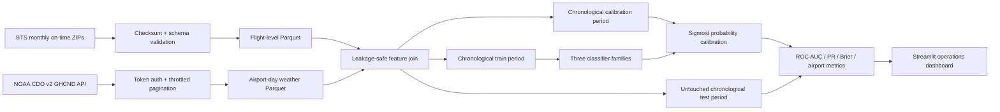

# Architecture and design decisions

## Prediction point

Both targets are framed at scheduled departure time. Features use the schedule, route, carrier, calendar, and same-day airport weather. Actual departure/arrival times, realized delays, cancellation codes, diverted status, and elapsed time are prohibited model inputs.

Daily historical weather is used because it is consistently available through the specified NOAA CDO interface. An operational forecast system should replace it with weather forecasts available at prediction time; otherwise a same-day historical weather join would not be available for future flights.

## Data grain

- BTS: one row per scheduled domestic flight record.
- NOAA: one row per airport weather station, date, and weather element before pivoting.
- Model table: one row per flight after origin/date and destination/date weather joins.

## Validation design

Whole flight dates are assigned in order: 70% train, 15% probability calibration, and 15% final test. The final period is not used for model or threshold selection. Average precision is the primary ranking metric because cancellation is rare; ROC AUC, Brier score, calibration, precision, recall, F1, and airport-level results provide complementary evidence.

